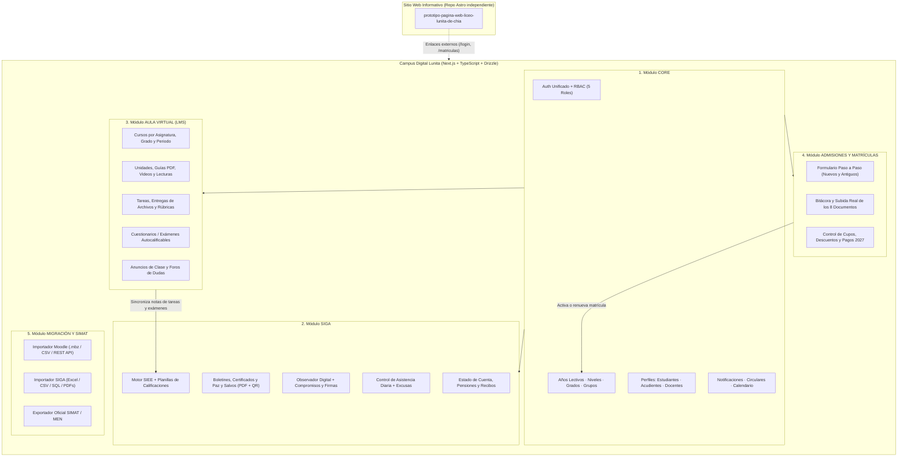
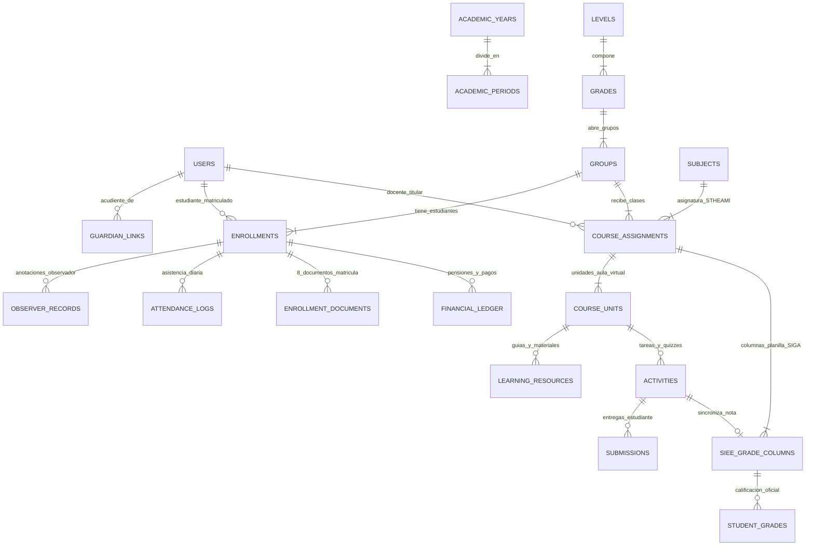

# Arquitectura Modular — Campus Digital Liceo Lunita de Chía

Este documento define la arquitectura técnica, los módulos de dominio, la estructura de carpetas y el modelo de base de datos relacional del **Campus Digital Liceo Lunita de Chía (SIGA + Aula Virtual + Matrículas)**.

---

## 1. Visión Arquitectónica: Monolito Modular (Feature-Driven)

En lugar de tener dos sistemas desconectados en servidores y bases de datos distintas (como ocurría con el SIGA en PHP y Moodle por separado), la plataforma utiliza una arquitectura de **Monolito Modular en Next.js (App Router) + TypeScript + Drizzle ORM**:

- **Un solo núcleo de identidad y estructura académica (`core`):** los usuarios, roles, años lectivos, niveles (Preescolar, Primaria, Bachillerato), grados (Prejardín a 11°), grupos, asignaturas y pilares **STHEAMI** existen una sola vez.
- **Cinco módulos desacoplados por dominio:**
  1. `core` — Autenticación, Roles (RBAC), Estructura Escolar, Usuarios, Notificaciones.
  2. `siga` — Calificaciones SIEE, Boletines y Certificados PDF+QR, Observador del Estudiante, Asistencia y Excusas, Agenda y Cartera.
  3. `aula` — Cursos por Asignatura/Grupo, Unidades por Periodo, Recursos/Guías, Tareas con Entregas y Rúbricas, Cuestionarios Autocalificables y Foros.
  4. `matriculas` — Admisiones y Matrícula en Línea 2027 (familias nuevas y antiguas), carga y validación de los 8 documentos oficiales, costos y cupos.
  5. `migracion` — Importadores desde Moodle (`.mbz`, XML, CSV, REST API) y desde SIGA (CSV/Excel, SQL, archivo histórico de boletines PDF), más exportación oficial para **SIMAT**.



---

## 2. Estructura de Carpetas del Proyecto

Ninguna lógica de negocio compleja ni consultas directas a base de datos deben vivir dentro de `src/app/`. Las rutas de `src/app/` solo orquestan vistas y llaman a los servicios y acciones de `src/modules/`.

```text
/Volumes/JOSE /Liceo Lunita de Chia/
├── README.md
├── ARQUITECTURA.md
├── REGLAS.md
├── SISTEMA_DISENO.md
├── PLAN_MIGRACION_Y_FASES.md
├── package.json
├── tsconfig.json
├── drizzle.config.ts
├── public/
│   ├── fonts/                        # Nunito Variable (.woff2 self-hosted)
│   └── brand/                        # Emblema Lunita, patrones Muisca, iconos STHEAMI
└── src/
    ├── app/                          # Capa de Enrutamiento (Next.js App Router)
    │   ├── (public)/                 # Rutas públicas sin sesión
    │   │   ├── login/                # Login unificado (SIGA + Aula Virtual)
    │   │   ├── recuperar-clave/      # Recuperación autónoma de contraseña
    │   │   ├── matriculas/           # Portal de Matrícula en Línea 2027 (4 pasos + 8 documentos)
    │   │   └── verificar/[codigo]/   # Validador público de QR para boletines y constancias
    │   │
    │   ├── (campus)/                 # Rutas protegidas con Layout del Campus Digital
    │   │   ├── dashboard/            # Panel principal adaptado al rol activo
    │   │   ├── aula/                 # Módulo Aula Virtual (LMS)
    │   │   │   ├── page.tsx          # Mis Cursos (filtrados por periodo y pilar STHEAMI)
    │   │   │   ├── [cursoId]/        # Vista del curso: Unidades, Recursos, Tareas, Quizzes, Foro
    │   │   │   └── tareas/           # Centro unificado "¿Qué tareas tengo?"
    │   │   ├── siga/                 # Módulo SIGA
    │   │   │   ├── calificaciones/   # Planilla SIEE (Docente) / Notas detalladas (Estudiante/Padre)
    │   │   │   ├── boletines/        # Generación y descarga de boletines y certificados PDF
    │   │   │   ├── observador/       # Observador del estudiante con descargos y firma acudiente
    │   │   │   ├── asistencia/       # Llamado a lista diario/por clase y gestión de excusas
    │   │   │   ├── agenda/           # Circulares, citaciones y cronograma institucional
    │   │   │   └── cartera/          # Estado de cuenta, pensiones, recibos y paz y salvo
    │   │   └── admin/                # Panel Directivo / Secretaría
    │   │       ├── estructura/       # Años lectivos, periodos, grados, grupos, materias STHEAMI
    │   │       ├── usuarios/         # Gestión de estudiantes, acudientes, docentes y roles
    │   │       ├── matriculas/       # Revisión de admisiones 2027 y aprobación de documentos
    │   │       └── migracion/        # Asistente de importación SIGA / Moodle y exportación SIMAT
    │   │
    │   └── api/                      # Endpoints para generación de PDFs, uploads y webhooks
    │
    ├── modules/                      # Lógica de Dominio por Módulo (Clean Modular Boundaries)
    │   ├── core/
    │   │   ├── auth/                 # Sesiones, hashing, middleware RBAC, selector de hijo
    │   │   ├── academic-structure/   # Años, niveles, grados, grupos, asignaturas, pilares STHEAMI
    │   │   └── notifications/        # Alertas internas, correo y avisos a acudientes
    │   ├── siga/
    │   │   ├── siee-grades/          # Motor de cálculo SIEE, escalas, cierres de periodo y auditoría
    │   │   ├── report-cards/         # Generador de boletines PDF, certificados y firma QR
    │   │   ├── observer/             # Anotaciones, tipos de falta/felicitación, descargos, actas
    │   │   ├── attendance/           # Registro de asistencia, retardos, excusas y alertas
    │   │   └── billing/              # Conceptos de cobro, pensiones, descuentos, paz y salvo
    │   ├── aula/
    │   │   ├── courses/              # Cursos, unidades temáticas, progreso del estudiante
    │   │   ├── resources/            # Guías PDF, enlaces, videos, lecturas
    │   │   ├── assignments/          # Tareas, entregas de archivos, rúbricas y calificación
    │   │   ├── quizzes/              # Banco de preguntas, intentos con tiempo y autocalificación
    │   │   └── grade-sync/           # Puente automático: Tarea/Quiz calificado -> Planilla SIGA
    │   ├── matriculas/
    │   │   ├── applications/         # Solicitudes de cupo y renovación de matrícula
    │   │   └── documents/            # Validación de los 8 documentos obligatorios
    │   └── migracion/
    │       ├── moodle-importer/      # Lector de backups .mbz / XML / CSV de Moodle
    │       ├── siga-importer/        # Lector de sábanas CSV/Excel y archivo de boletines PDF
    │       └── simat-exporter/       # Generador de plano compatible con SIMAT
    │
    ├── components/
    │   ├── ui/                       # Design System Táctil Lunita (TactileCard, PillButton, etc.)
    │   └── layout/                   # CampusSidebar, TopHeader, ChildSwitcher, RoleBadge
    │
    └── db/
        ├── index.ts                  # Conexión Drizzle ORM (PostgreSQL con pool `pg`, desarrollo y producción)
        ├── schema/                   # Tablas organizadas por módulo
        │   ├── core.ts
        │   ├── siga.ts
        │   ├── aula.ts
        │   ├── matriculas.ts
        │   └── audit.ts
        └── seed/                     # Datos iniciales reales de Liceo Lunita de Chía
```

---

## 3. Modelo de Base de Datos Relacional

El esquema relacional garantiza integridad referencial completa entre la estructura escolar, el Aula Virtual y el SIGA.



### Tablas Nucleares por Módulo

#### A. Módulo `core` (`src/db/schema/core.ts`)
- `users`: `id`, `document_type`, `document_number` (único), `email`, `password_hash`, `first_name`, `last_name`, `role` (`STUDENT`, `GUARDIAN`, `TEACHER`, `COORDINATOR`, `ADMIN`), `avatar_url`, `phone`, `is_active`, `created_at`.
- `guardian_links`: `id`, `guardian_id`, `student_id`, `relationship` (Madre, Padre, Acudiente), `is_financial_responsible`, `can_pick_up`.
- `academic_years`: `id`, `year` (ej. `2026`, `2027`), `name`, `is_current`, `enrollment_open`, `start_date`, `end_date`.
- `academic_periods`: `id`, `academic_year_id`, `number` (1 a 4), `name` (`Primer Periodo`, etc.), `weight_percent` (ej. `25`), `grades_locked`, `start_date`, `end_date`.
- `levels`: `id`, `code` (`PREESCOLAR`, `PRIMARIA`, `BACHILLERATO`), `name`.
- `grades`: `id`, `level_id`, `name` (`Prejardín`, `Jardín`, `Transición`, `Primero` … `Undécimo`), `display_order`, `simat_code`.
- `groups`: `id`, `academic_year_id`, `grade_id`, `name` (ej. `6A`, `11A`), `director_teacher_id`, `capacity`.
- `subjects`: `id`, `name`, `code`, `stheami_pillar` (`S`, `T`, `H`, `E`, `A`, `M`, `I`), `weekly_hours`.
- `course_assignments`: `id`, `academic_year_id`, `group_id`, `subject_id`, `teacher_id` (representa una materia dictada a un grupo específico tanto en SIGA como en Aula Virtual).

#### B. Módulo `siga` (`src/db/schema/siga.ts`)
- `enrollments`: `id`, `student_id`, `academic_year_id`, `group_id`, `status` (`ACTIVE`, `PRE_ENROLLED`, `WITHDRAWN`, `GRADUATED`), `enrollment_type` (`NEW`, `RENEWAL`), `enrolled_at`.
- `siee_competencies`: `id`, `course_assignment_id`, `period_id`, `dimension` (`SABER`, `HACER`, `SER`), `description` (logro / indicador / DBA), `weight_percent`.
- `siee_grade_columns`: `id`, `course_assignment_id`, `period_id`, `competency_id`, `title`, `weight_percent`, `linked_activity_id` (nullable: apunta a una tarea o quiz del Aula Virtual).
- `student_grades`: `id`, `column_id`, `enrollment_id`, `numeric_score` (escala del colegio, ej. `1.0` a `5.0`), `performance_level` (`SUPERIOR`, `ALTO`, `BASICO`, `BAJO`), `feedback`, `updated_by`, `updated_at`.
- `observer_records`: `id`, `enrollment_id`, `period_id`, `author_id`, `category` (`PRAISE`, `ACADEMIC`, `TYPE_I`, `TYPE_II`, `TYPE_III`), `title`, `description`, `student_statement` (descargos), `commitment` (compromiso), `guardian_acknowledged_at`, `guardian_acknowledged_by`, `created_at`.
- `attendance_logs`: `id`, `enrollment_id`, `course_assignment_id` (o jornada), `date`, `status` (`PRESENT`, `ABSENT`, `LATE`, `EXCUSED`), `excuse_file_url`, `excuse_approved_by`, `notes`.
- `report_cards`: `id`, `enrollment_id`, `period_id`, `verification_code` (UUID/hash para QR), `average_score`, `ranking_position`, `director_observations`, `pdf_url`, `issued_at`.
- `financial_ledger`: `id`, `enrollment_id`, `concept` (`MATRICULA_2027`, `PENSION_MES`, `OTROS`), `due_date`, `amount`, `discount_amount`, `status` (`PENDING`, `PAID`, `OVERDUE`), `payment_method` (`NEQUI`, `DAVIPLATA`, `BRE_B`, `PSE`, `TESORERIA`), `receipt_number`.

#### C. Módulo `aula` (`src/db/schema/aula.ts`)
- `course_units`: `id`, `course_assignment_id`, `period_id`, `title`, `description`, `display_order`, `is_published`.
- `learning_resources`: `id`, `unit_id`, `type` (`PDF`, `VIDEO`, `LINK`, `RICH_TEXT`), `title`, `content_or_url`, `file_size`, `display_order`.
- `activities`: `id`, `unit_id`, `type` (`ASSIGNMENT`, `QUIZ`, `FORUM`), `title`, `instructions`, `due_date`, `max_score`, `allow_late`, `sync_to_siga` (boolean).
- `submissions`: `id`, `activity_id`, `enrollment_id`, `text_response`, `attachment_url`, `submitted_at`, `score`, `teacher_feedback`, `graded_by`, `graded_at`.
- `quiz_questions` y `quiz_attempts`: soporte de preguntas de opción múltiple, verdadero/falso, emparejamiento y respuesta abierta para evaluaciones en línea.

#### D. Módulo `matriculas` (`src/db/schema/matriculas.ts`)
- `admission_applications`: `id`, `academic_year_id`, `applicant_type` (`NEW_FAMILY`, `EXISTING_FAMILY`), `student_data_json`, `guardian_data_json`, `requested_grade_id`, `step_completed` (1 a 4), `status` (`DRAFT`, `SUBMITTED`, `DOCS_REVIEW`, `APPROVED`, `ENROLLED`).
- `enrollment_documents`: `id`, `application_id`, `doc_code` (los 8 documentos de la bitácora de admisión de Lunita), `file_url`, `status` (`PENDING`, `UPLOADED`, `APPROVED`, `REJECTED`), `reviewer_notes`.

#### E. Módulo `audit` (`src/db/schema/audit.ts`)
- `audit_logs`: `id`, `actor_user_id`, `action` (`GRADE_UPDATED`, `PERIOD_UNLOCKED`, `OBSERVER_CREATED`, `ENROLLMENT_APPROVED`), `entity_type`, `entity_id`, `before_json`, `after_json`, `ip_address`, `created_at`.

---

## 4. Flujo de Sincronización Aula Virtual → SIGA

1. El docente crea una **Tarea** o **Cuestionario** en el Aula Virtual (`/aula/[cursoId]`) y marca la opción **"Sincronizar con Planilla SIGA"** asignándole la dimensión del SIEE (*Saber*, *Hacer* o *Ser*).
2. El sistema crea o vincula automáticamente la columna correspondiente en `siee_grade_columns`.
3. Cuando el docente califica la entrega del estudiante (o cuando el cuestionario se autocalifica al terminar), el servicio `grade-sync` actualiza `student_grades` en el SIGA, recalcula el promedio parcial de la asignatura, asigna el desempeño (*Superior*, *Alto*, *Básico*, *Bajo*) y registra el evento en `audit_logs`.
4. El estudiante y el padre ven inmediatamente la nota tanto en la tarea del Aula Virtual como en el módulo de Calificaciones del SIGA.
