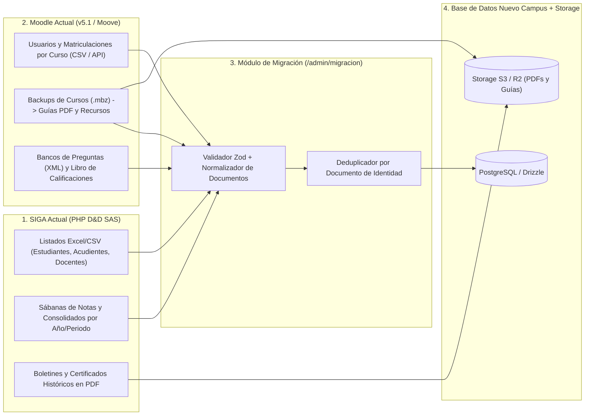

# Plan de Fases y Protocolo de Migración — Campus Digital Liceo Lunita de Chía

Este documento detalla la hoja de ruta de construcción en **5 fases incrementales** y el protocolo técnico para migrar la información existente desde el **SIGA actual** (`siga.liceolunita.edu.co`) y **Moodle** (`26.aula2021.liceolunita.edu.co`) sin pérdida de datos.

---

## Parte 1: Hoja de Ruta de Construcción (5 Fases)

### Fase 1 — Base Arquitectónica, Diseño Táctil Lunita y Módulo `core` (MVP Base)
- [x] Inicializar proyecto **Next.js (App Router) + TypeScript + Tailwind CSS + Drizzle ORM**.
- [x] Configurar variables CSS, fuente `Nunito Variable` y componentes base de [`SISTEMA_DISENO.md`](./SISTEMA_DISENO.md) (`PillButton`, `TactileCard`, `IconBubble`, `StheamiBadge`, `PerformanceBadge`).
- [x] Implementar esquema Drizzle de `core` + script de **Seed Institucional** con:
  - Niveles: *Preescolar*, *Primaria* y *Bachillerato*.
  -Los 14 grados del colegio: *Prejardín*, *Jardín*, *Transición*, *Primero* a *Undécimo*.
  - Asignaturas vinculadas a los 7 pilares **STHEAMI** (`S, T, H, E, A, M, I`).
  - Periodos académicos configurados con pesos SIEE.
  - Usuarios semilla para probar los 5 roles (*Estudiante*, *Padre/Acudiente*, *Docente*, *Coordinación*, *Secretaría/Admin*).
- [x] Construir pantalla de **Login Unificado** (`/login`) con estética cósmica Lunita y accesos rápidos de demostración por rol.
- [x] Construir **Layout del Campus** (Sidebar adaptativo + barra inferior móvil `.tabbar` + buscador global `Ctrl+K` + selector de hijo para acudientes) y **Dashboard Personalizado por Rol** (`/dashboard`).

### Fase 2 — Módulo `siga` (Calificaciones SIEE, Boletines PDF+QR, Observador y Asistencia)
- [ ] **Planilla SIEE para Docentes (`/siga/calificaciones`):** tabla editable tipo hoja de cálculo con cálculo automático por dimensión (*Saber*, *Hacer*, *Ser*), conversión a escala (*Superior*, *Alto*, *Básico*, *Bajo*) y registro de auditoría en `audit_logs`.
- [ ] **Consulta de Notas y Boletines para Estudiantes/Padres (`/siga/boletines`):** vista por periodo, gráfica de evolución por pilar STHEAMI y generación de **Boletín Oficial en PDF con cenefa Muisca y código QR** verificable en `/verificar/[codigo]`.
- [ ] **Observador Digital del Estudiante (`/siga/observador`):** creación de anotaciones (*Felicitación*, *Académico*, *Tipo I, II, III*), descargos del estudiante, compromisos y botón de confirmación (*Enterado*) para el acudiente.
- [ ] **Control de Asistencia y Excusas (`/siga/asistencia`):** toma de asistencia rápida desde móvil/escritorio, alertas de inasistencia y radicación/aprobación de excusas médicas.
- [ ] **Agenda y Circulares (`/siga/agenda`):** comunicados institucionales con confirmación de lectura y calendario de eventos descargable (`.ics`).

### Fase 3 — Módulo `aula` (Aula Virtual estilo Moodle Conectada al SIGA)
- [ ] **Mis Cursos (`/aula`):** tarjetas táctiles de las asignaturas del estudiante o docente con insignia **STHEAMI**, progreso del periodo y próximas entregas (sin exponer cursos al público).
- [ ] **Interior del Curso (`/aula/[cursoId]`):** organizado por Periodos / Unidades temáticas con:
  - **Recursos y Guías:** visor integrado de PDFs, videos, lecturas y materiales descargables.
  - **Tareas y Entregas:** subida de archivos o respuesta en línea, fecha límite, calificación con rúbrica y retroalimentación del docente.
  - **Cuestionarios / Exámenes:** preguntas de opción múltiple, verdadero/falso y abiertas con temporizador y calificación automática.
  - **Foro / Anuncios de la Clase:** dudas y avisos por materia.
- [ ] **Centro "¿Qué tareas tengo?" (`/aula/tareas`):** bandeja unificada para estudiantes y padres con filtros (*Pendientes*, *Entregadas*, *Calificadas*).
- [ ] **Puente automático Aula Virtual → SIGA:** sincronización transaccional de la nota de cada tarea o examen directamente hacia la columna vinculada en la planilla SIEE del SIGA.

### Fase 4 — Módulo `matriculas` y `cartera` (Admisiones 2027 y Estado de Cuenta)
- [ ] **Portal Público/Privado de Matrícula en Línea (`/matriculas`):**
  - Flujo guiado de 4 pasos para **Familias Nuevas** y **Familias Antiguas (Renovación con datos precargados)**.
  - Calculadora transparente de costos y descuentos por grado (Preescolar, Primaria, Bachillerato).
  - **Bitácora Real de los 8 Documentos:** evolución de la bitácora del prototipo Astro con subida real de archivos PDF/imagen y estado de revisión por secretaría (*Pendiente*, *En revisión*, *Aprobado*, *Subsanar*).
- [ ] **Módulo de Cartera y Pagos (`/siga/cartera`):** estado de pensiones, registro de pagos (Nequi, Daviplata, Bre-B, PSE, Tesorería), recibos en PDF y emisión automática de **Paz y Salvo**.

### Fase 5 — Módulo `migracion`, Exportación SIMAT y Unión con el Sitio Web en Astro
- [ ] **Asistente de Importación (`/admin/migracion`):** carga guiada con previsualización y validación Zod para archivos de SIGA y Moodle.
- [ ] **Exportador SIMAT:** generación de reportes planos compatibles con el Ministerio de Educación Nacional.
- [ ] **Unión en Producción con la Web en Astro:** actualización de los 3 enlaces externos en el repositorio del sitio informativo para apuntar al nuevo Campus Digital desplegado.

---

## Parte 2: Protocolo Técnico de Migración (SIGA y Moodle → Nuevo Campus)

Para no perder ningún dato histórico del colegio, la migración se divide en cuatro flujos ordenados:

### Paso 1: Unificación de Identidad (Clave Única por Documento)
- Hoy un mismo estudiante o docente tiene un usuario en SIGA y otro distinto en Moodle.
- El importador unifica ambos perfiles usando el **Número de Documento de Identidad** (TI / RC / CC) y el **Correo Electrónico** como llaves de cruce, creando una **única cuenta** en la tabla `users`.

### Paso 2: Migración desde el SIGA Actual (`siga.liceolunita.edu.co`)
1. **Estudiantes, Acudientes y Matrículas:**
   - Se importan desde los reportes Excel/CSV de matrícula o SIMAT del colegio (o desde un volcado SQL si el proveedor lo entrega).
   - Se crean automáticamente los vínculos familiares en `guardian_links`.
2. **Historial de Notas y Observador:**
   - Las sábanas de notas por periodo/año se importan en `student_grades` asociadas a su año lectivo (`2021` a `2026`).
3. **Archivo Histórico de Boletines en PDF:**
   - Los boletines finales de años anteriores ya emitidos en PDF se guardan en el almacenamiento seguro y se vinculan a `report_cards`, permitiendo que secretaría o los padres los descarguen en cualquier momento.

### Paso 3: Migración desde Moodle (`26.aula2021.liceolunita.edu.co`)
1. **Limpieza previa al importar:**
   - Se excluyen categorías obsoletas (como `ADMISIONES 2023`) y se corrigen nombres con erratas (como `Trasición` → `Transición`).
2. **Extracción de Cursos y Recursos (`.mbz` o REST API de Moodle):**
   - Un archivo de respaldo `.mbz` de Moodle es un archivo comprimido `.tar.gz` que contiene `moodle_backup.xml`, `files.xml` y la carpeta `files/` con todos los PDFs y guías subidas por los docentes.
   - El script `moodle-importer` descomprime el `.mbz` (o consulta los Web Services de Moodle), extrae las unidades temáticas, sube los PDFs al nuevo Storage y registra los recursos en `course_units` y `learning_resources`.
3. **Bancos de Preguntas:**
   - Los cuestionarios exportados en formato **Moodle XML** se convierten directamente a `quiz_questions` para que los docentes conserven todas sus evaluaciones.

### Paso 4: Validación y Marcha Blanca en Paralelo
- Antes del corte definitivo, el panel `/admin/migracion` genera un **Acta de Conciliación de Datos** comparando:
  - Total de estudiantes activos por grado y grupo.
  - Total de docentes y cargas académicas (`course_assignments`).
  - Muestreo de promedios de notas y boletines históricos.
