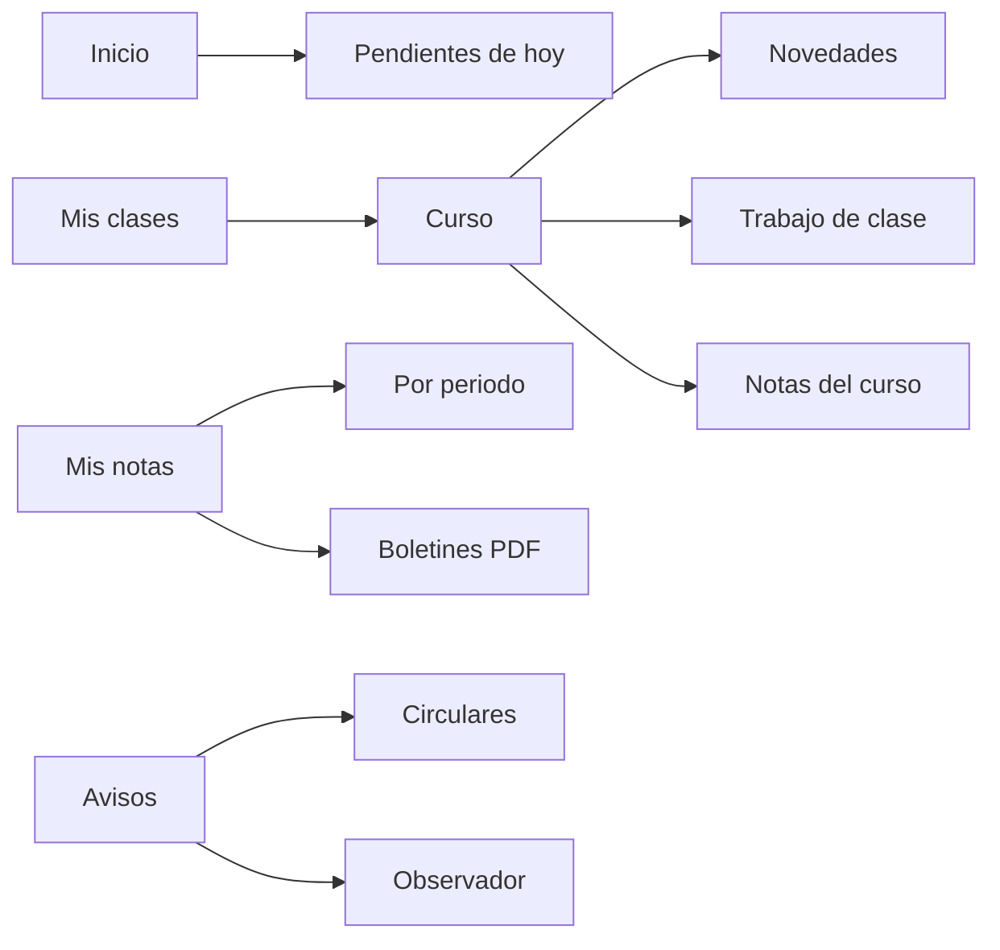

# Propuesta UX: navegación más amable, contenido mínimo y Aula ampliada

**Fecha:** 2026-11-27 · **Estado:** propuesta para aprobar antes de rediseñar los paneles.
**Ya implementado en esta entrega:** nuevo login "Noche en Chía" con Lunita animada y Lunita como logo dentro del Aula (Órbita Virtual).

---

## 1. Diagnóstico: por qué hoy abruma

El panel del acudiente muestra **9 bloques en una sola pantalla**: saludo + periodo, tarjetas de hijos, "Elige tu espacio de trabajo" con dos zonas, gráfica de evolución, meta de Órbita, 11 tarjetas de asignaturas, ficha de grupo y mapa STHEAMI. El de estudiante y el de docente siguen el mismo patrón.

Problemas concretos:
1. **Todo compite**: no hay una acción principal; el usuario tiene que leer para decidir.
2. **Doble navegación**: menú lateral + selector de zona (Órbita / SIGA / Todo) + tarjetas de zona en el panel hacen lo mismo tres veces.
3. **Jerga de producto**: "Zona 1", "ecosistema", "Órbita", "SIGA Lunita" obligan a aprender nombres internos.
4. **Datos de consulta ocasional** (mapa STHEAMI, ficha de grupo) ocupan el mismo peso que lo urgente (tareas, firmas pendientes).

---

## 2. Referencias y qué tomar de cada una

| Referencia | Qué hace bien | Qué adoptamos |
| :--- | :--- | :--- |
| **Google Classroom** | Interfaz limpia con pocas pestañas; el curso es "Novedades · Trabajo de clase · Personas". Los usuarios la califican más fácil que Canvas. | Página de curso con **3 pestañas fijas** iguales en todos los cursos. |
| **Canvas LMS** | Navegación lateral del curso clara… pero cada docente organiza distinto y eso confunde. | **Estructura obligatoria** por periodo → unidad; el docente personaliza el aspecto, no la estructura. |
| **Duolingo** (ya es nuestra base visual) | Una pantalla = una acción principal; progreso como camino. | Inicio del estudiante de primaria como **camino de misiones**; un botón principal por pantalla. |
| **ClassDojo** (familias) | El padre ve primero "qué pasó hoy" de su hijo, no menús. | Inicio del acudiente como **resumen del día del hijo** + bandeja de pendientes. |
| **Wayground (ex-Quizizz)** | 18+ tipos de pregunta, videos interactivos, lecciones y tarjetas de estudio. | Nuevos tipos de pregunta y **video con preguntas** (ver §5). |
| **Blooket / Kahoot** | Un mismo banco de preguntas jugado en modos distintos; modo en vivo. | **Modo en vivo** en clase con el mismo cuestionario. |
| **Blackboard (rediseño 2025–2026)** | Priorizó navegación para estudiantes y docentes; mejoras de usabilidad iterativas. | Medir con usuarios reales (3–5 familias, 3 docentes) antes y después. |

Principios comunes de las guías de UX de LMS: interfaz limpia y con propósito, navegación intuitiva "no negociable", contenido en bloques simples con pocos clics y vistas distintas por rol.

---

## 3. Nueva arquitectura de navegación

**Regla:** máximo **4 destinos** en la barra (lateral en escritorio, inferior en móvil), con nombres comunes, y el mismo orden para todos. Se elimina el selector de zonas y las tarjetas "Elige tu espacio".

| Rol | Destino 1 | Destino 2 | Destino 3 | Destino 4 |
| :--- | :--- | :--- | :--- | :--- |
| Estudiante | **Inicio** | **Mis clases** (cursos + tareas) | **Mis notas** (notas + boletines) | **Avisos** (agenda, observador) |
| Acudiente | **Inicio** | **Notas** | **Asistencia** | **Pagos** · avisos en Inicio |
| Docente | **Hoy** | **Mis clases** (Aula + planilla por curso) | **Asistencia** | **Observador** |
| Directivos | **Resumen** | **Estructura** | **Usuarios** | **Reportes** (boletines, auditoría, migración) |

- Todo lo demás vive **dentro** de esos destinos (pestañas), o en el buscador `Ctrl+K`.
- El nombre "Órbita Virtual" puede quedar como marca en el encabezado del Aula, pero el menú dice **"Mis clases"**.



---

## 4. Contenido mínimo por pantalla de inicio

**Regla:** 3 bloques como máximo encima del pliegue; lo de consulta ocasional va detrás de "Ver más".

```
ESTUDIANTE (bachillerato)                 ACUDIENTE
┌──────────────────────────────┐          ┌──────────────────────────────┐
│ Hola, Sofía · 7A · P4 (4 días)│          │ Sofía ▾  (cambia de hijo)     │
├──────────────────────────────┤          ├──────────────────────────────┤
│ PARA HOY (máx. 3)            │          │ PENDIENTES (solo si hay)      │
│ • Taller de fracciones  ▸    │          │ • Firmar anotación  [Firmar]  │
│ • Quiz de inglés        ▸    │          │ • Falla del lunes [Excusa]    │
├──────────────────────────────┤          ├──────────────────────────────┤
│ MIS CLASES (lista compacta)  │          │ RESUMEN DE SOFÍA              │
│ M Matemáticas   4.2 ▸        │          │ Promedio 4.1 · Asistencia 96% │
│ S Ciencias      3.8 ▸        │          │ [Ver notas] [Último boletín]  │
│ … Ver todas (11)             │          │                                │
└──────────────────────────────┘          └──────────────────────────────┘

DOCENTE ("Hoy")
┌──────────────────────────────────────────────┐
│ Hoy: 3 clases · 12 entregas por calificar     │
├──────────────────────────────────────────────┤
│ 7A Matemáticas 8:00  [Asistencia] [Planilla]  │
│ 9A Matemáticas 10:00 [Asistencia] [Planilla]  │
├──────────────────────────────────────────────┤
│ Por calificar (12) ▸   Dirección 7A ▸         │
└──────────────────────────────────────────────┘
```

Se retiran del inicio: gráfica de evolución (pasa a "Mis notas"), mapa STHEAMI (pasa a la página del curso o al boletín), ficha de grupo (pasa a "Mis clases").

---

## 5. Personalización docente y Aula ampliada

**Hoy existe:** recursos PDF, video (solo como enlace externo), enlace y texto; cuestionarios de opción única, opción múltiple, verdadero/falso y respuesta corta; personalizador de portada y color del curso.

**Hallazgo técnico:** los videos solo se abren fuera del Campus. Para incrustar YouTube/Vimeo hay que permitirlo en la CSP (`frame-src` con lista blanca), hoy bloqueado por seguridad.

### 5.1 Contenido de curso
| Mejora | Detalle | Esfuerzo |
| :--- | :--- | :--- |
| Video incrustado | YouTube (modo `youtube-nocookie.com`), Vimeo y Google Drive, con lista blanca en `frame-src`. | Bajo |
| Video propio | Subida de MP4 (≤ 200 MB) a almacenamiento privado con reproducción protegida. | Medio |
| **Video interactivo** (tipo Edpuzzle) | El docente pone preguntas en minutos del video; el video se pausa y la respuesta va a la planilla. | Medio |
| Recursos incrustables | Genially, Canva, GeoGebra, PhET, Wordwall, Google Slides (lista blanca). | Bajo |
| Lecciones paso a paso | Secuencia de diapositivas con texto, imagen, video y pregunta al final. | Medio |
| Publicación programada | "Visible desde el lunes 7:00" por unidad o recurso. | Bajo |
| Plantillas y duplicar | Clonar unidad o curso completo a otro grupo/año (ya en el plano 04). | Medio |

### 5.2 Cuestionarios más interesantes
| Tipo / función | Para qué |
| :--- | :--- |
| Emparejar, ordenar, completar espacios | Vocabulario, procesos, fórmulas. |
| Pregunta con imagen y **zona sobre imagen** (hotspot) | Mapas, partes del cuerpo, geometría. |
| Pregunta con audio y respuesta grabada | Inglés y lectura en voz alta (primaria). |
| Respuesta abierta con **rúbrica** | Argumentación; nota manual que sincroniza con SIGA. |
| Explicación por pregunta | El estudiante aprende del error al terminar. |
| Banco de preguntas y mezcla aleatoria | Reutilizar entre grupos y evitar copia. |
| **Modo en vivo en clase** (tipo Kahoot) | Proyector + celulares; Lunita celebra a los grupos. Opcional: sin ranking público en primaria. |
| Tarjetas de estudio (flashcards) | Repaso antes del quiz. |
| Insignias | "Racha de 5 tareas", "Superior en Matemáticas"; visibles en el perfil (Moodle ya tenía insignias). |

---

## 6. SIGA y Moodle anteriores frente al Campus

Revisión en modo lectura de las sesiones abiertas (SIGA como Coordinación y Moodle 26.aula2021).

### Lo que ya mejoramos
| Antes | Ahora |
| :--- | :--- |
| Dos plataformas, dos usuarios y dos contraseñas | Un solo ingreso, roles automáticos y recuperación de contraseña autónoma |
| Moodle exponía cursos y docentes sin sesión | Nada es público sin sesión; permisos por rol en el servidor |
| Notas de Moodle copiadas a mano al SIGA | Tarea o quiz calificado → planilla SIEE automáticamente |
| Planilla en formularios por estudiante | Planilla tipo hoja de cálculo con autoguardado y teclado |
| Sin trazabilidad de cambios de notas | Auditoría por celda (antes/después, autor, hora) y periodos con candado y ventanas temporales |
| Boletín sin verificación | Boletín PDF con QR verificable |
| Diseño de escritorio | Móvil primero, tema por etapa (primaria/bachillerato) |

### Lo que el sistema anterior tenía y conviene sumar
| Función del sistema anterior | Dónde estaba | Propuesta |
| :--- | :--- | :--- |
| **Recuperaciones** | SIGA › Notas › Recuperaciones | Columna de recuperación por periodo con nota máxima configurable y auditoría |
| **Banco de logros** (agregar, asignar, exportar PDF por asignatura/curso) | SIGA › Gestión de Logros y Reportes | Banco reutilizable por grado y asignatura + exportación PDF |
| **Quinto boletín** (boletín final del año) | SIGA › Boletines | Boletín anual con definitiva ponderada (el cálculo ya existe) |
| **Formatos institucionales** (guías, planeación semanal, programación general) | SIGA › Formatos | Biblioteca de plantillas descargables para docentes |
| **Listas PDF** (colegio A–Z y por curso) | SIGA › Formatos | Exportación de listas desde Usuarios |
| **Reportes** (definitivas y notas por asignatura, fallas por estudiante) | SIGA › Reportes | Sección "Reportes" de directivos (§3) |
| **Insignias, mensajería, calendario con línea de tiempo, archivos privados, modo oscuro** | Moodle | Insignias y calendario en la primera ola; mensajería con moderación (menores) en la segunda; modo oscuro opcional |

---

## 7. Orden sugerido
1. **Navegación de 4 destinos + inicios mínimos** (§3–4). Mayor impacto en la sensación de "abrumado".
2. **Video incrustado + recursos incrustables + publicación programada** (§5.1, bajo esfuerzo).
3. **Nuevos tipos de pregunta + explicación + banco** (§5.2).
4. **Recuperaciones, banco de logros y boletín final** (§6, continuidad con el SIGA anterior).
5. **Video interactivo, modo en vivo e insignias.**

## Fuentes
- [Faculty Focus — UX de cursos que los estudiantes pueden navegar](https://www.facultyfocus.com/articles/online-education/students-perception-of-ux-design-on-an-lms-course-designing-online-courses-students-can-actually-navigate/)
- [Edutopia — Diseñar el LMS para mejorar el aprendizaje a distancia](https://www.edutopia.org/article/designing-your-lms-make-distance-learning-better)
- [DEV — Buenas prácticas UX/UI para LMS](https://dev.to/ayatas_technologies_ec1ca/uxui-best-practices-for-lms-development-1bkh)
- [Estudio de tablero de aprendizaje en Moodle (SciTePress 2024)](https://www.scitepress.org/Papers/2024/123746/123746.pdf)
- [Blackboard — Experiencia de curso renovada](https://www.blackboard.com/blog/new-year-new-ui-blackboards-refreshed-course-experience-delivers-results)
- [Caso de estudio: rediseño del portal docente de un LMS](https://medium.com/@joshgary24/redesigning-teachers-portal-of-a-learning-management-system-a-product-design-case-study-e4ed45071b73)
- [Teachfloor — Canvas vs Google Classroom](https://www.teachfloor.com/blog/canvas-vs-google-classroom)
- [G2 — Canvas vs Google Classroom](https://www.g2.com/compare/canvas-vs-google-classroom)
- [Jotform — Alternativas a Wayground (Quizizz)](https://www.jotform.com/blog/quizizz-alternatives/)
- [Engageli — Mejores juegos de quiz 2026](https://www.engageli.com/blog/best-online-quiz-games)
